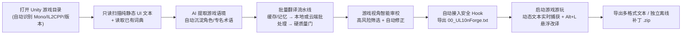

<div align="center">

# UL10nForge · Unity 游戏本地化工坊

**零侵入、纯显示层的 Unity 游戏智能汉化工作台**

绝不改动任何游戏原文件 · 支持本地离线双模型与省 Token 云端 API · 纯静态安全预扫 + 游戏内实时补全 + `Alt+L` 悬浮即时改译

<p>
  
  
  
  
  
</p>

<p>
  <a href="#核心特性">核心特性</a> ·
  <a href="#工作原理">工作原理</a> ·
  <a href="#快速开始">快速开始</a> ·
  <a href="#模型与云端-api-配置">模型与云端 API</a> ·
  <a href="#项目结构">项目结构</a> ·
  <a href="#常见问题">常见问题</a>
</p>

</div>

---

## 为什么做 UL10nForge？

传统 Unity 汉化往往面临两难：**直接解包改资产**容易黑屏、坏档、版本一更新就失效；**纯靠传统实时机翻插件**又常常术语前后矛盾、机翻腔严重、改译麻烦，遇到 IL2CPP 或老版 Unity 还容易乱码报错。

**UL10nForge** 把两者优势合二为一：底层用成熟的 `BepInEx / MelonLoader + XUnity.AutoTranslator` 仅在显示层无损替换文本，上层提供完整的 AI 语境理解、术语记忆、智能审校、可视化精修工作台与独立离线补丁导出。

| 对比维度 | 传统解包改包 | 普通实时机翻插件 | **UL10nForge** |
| :--- | :--- | :--- | :--- |
| **游戏安全性** | 修改原文件，易崩/坏档 | 零侵入，但 IL2CPP 配置易踩坑 | **100% 零侵入** + IL2CPP 安全配置自愈 + 保留玩家原有 Mod |
| **翻译质量** | 依赖人工 | 逐句孤立直译，人名术语混乱 | **语境档案 + 术语表 + 跨游戏记忆 + 质量门 + 游戏视角审校** |
| **实时 & 离线** | 仅静态离线 | 强依赖后台翻译服务 | **双闭环**：边玩边翻自动沉淀词典，后续可完全离线游玩或打包 `.zip` 分享 |
| **云端 Token 成本** | — | 逐句发送，重复消耗大 | **JSON 批处理 + 本地零 Token 缓存**，云端输入 Token 降约 70%–85% |
| **游戏内改译** | 需退出重新打包 | 需手改 `.txt` 文本文件 | 游戏中按 **`Alt+L`** 呼出悬浮窗即时修改，保存即热同步生效 |

---

## 核心特性

### 1. 100% 游戏安全，绝不改动游戏原文件
- **自动识别 Unity 架构**：纯 Python 自动探测 Mono / IL2CPP、x64 / x86、Unity 具体版本号与嵌套目录。
- **IL2CPP 专属安全加固**：针对 IL2CPP 游戏仅启用稳定的 `UGUI` 与 `TextMeshPro` 钩子，关闭易引发 `Il2CppInterop` 空引用的裁剪框架钩子，并自动配置 `UnityLogListening = false` 与安全静默模式。
- **字体版本前向兼容**：按 Unity 版本精确匹配 `u2019 / u2021 / u2022 / u6000` 预编译 TMP 中文字体包，Unity `< 2019` 自动跳过不兼容 AssetBundle，杜绝老游戏启动乱码。
- **无损卸载 & 启动自愈**：每次点击「启动游戏」自动确保插件接入、安全配置刷新与词典最新同步；卸载仅精准清理本工具安装清单，完整保留玩家原有 Mod。

### 2. 纯静态安全预扫 × 实时动态补全
- **克制的静态预扫**：仅只读扫描 100% 安全的标准 Unity UI 组件（`TextMeshProUGUI` / `TextMeshPro` / `TMP_Text` / `Text` / `TextMesh`），绝不贪心抓取代码字符串或二进制脚本噪音；剧情与动态拼接文本交由钩子在游玩时实时捕获。
- **静态与实时清晰分离**：译文审校页支持按 **全部来源 / 静态文本 / 实时翻译** 与状态筛选自由组合，翻译与游戏内捕获进度通过 SSE 自动实时刷新，无需手动点刷新。

### 3. 本地离线双模型 × 省 Token 云端 API
- **本地全离线（零联网、零隐私上传）**：
  - 主翻译引擎：`Hy-MT3-1.8B`（低延迟并发翻译）；
  - 语境与审校引擎：`Qwen3.5-4B`（按需自动拉起，空闲自动释放显存）；
  - 硬件自动适配：`CUDA 12.4 → Vulkan（含 RTX 50 系 Blackwell / AMD / Intel）→ CPU` 自动降级，并支持单模型极简模式。
- **云端 OpenAI 兼容 API（大幅省 Token）**：
  - 原生兼容 OpenAI、DeepSeek、Google Gemini、火山引擎豆包、智谱 GLM、阿里百炼、硅基流动等网关；
  - 自动剥离推理模型 `<think>` 块，支持 `429 / 502 / 503 / 504` 自动退避重试与 `Retry-After`；
  - **JSON 编号批处理 + 严格单条质检回退**：先用 0 Token 命中内置 UI 词库与跨游戏记忆，其余按批打包翻译，任意一条遗漏或占位符受损自动单条重译，既省 70%–85% Token 又 100% 保证传递准确；任务结束实时显示本次 Token 消耗。

### 4. 游戏视角智能审校 & 高效精修体验
- **智能高风险筛选 + 克制修改**：默认「智能审校」0ms 放行常规菜单与时间/数值标签，只把长句、否定/条件句、富文本标签、术语冲突与长度异常提交模型；完整注入游戏世界观与角色设定，以玩家视角把关，准确自然就不乱改。也支持「更多 ▾ → 深度全量审校」随时复审。
- **人工改译自动保护**：在工作台或游戏内 **`Alt+L`** 悬浮窗修改并保存译文后，后台自动保护防止被后续批量任务覆盖；支持单条一键还原上一版、标记「不翻 / 恢复」、全局批量查找替换。
- **多格式导出 & 独立离线补丁**：支持一键导出 **JSON / 词典 TXT / 双语对照 TXT / Markdown / CSV（Excel 无乱码）**，以及可发给任意玩家「解压即玩、无需本工具与联网」的**独立离线中文补丁 `.zip`**。

---

## 工作原理



---

## 快速开始

### 方式一：解压即用便携版（推荐）

从 [Releases](https://github.com/mingminghh611/UL10nForge/releases) 下载整合包解压到任意路径，双击根目录下的：

```bat
启动UL10nForge.bat
```

程序会自动使用内置便携 Python 启动本地工作台并打开浏览器（默认 `http://127.0.0.1:18765`）。

### 方式二：从源码运行（开发者 / 纯云端 API 用户）

环境要求：**Windows 10/11**、**Python 3.12+**。

```bash
# 1. 克隆仓库
git clone https://github.com/mingminghh611/UL10nForge.git
cd UL10nForge

# 2. 安装依赖
pip install -r requirements.txt

# 3. 启动工作台
python main.py
```

#### 常用启动参数

| 参数 | 说明 | 默认值 |
| :--- | :--- | :--- |
| `--host` | 监听地址 | `127.0.0.1` |
| `--port` | 服务端口（`0` 表示读取设置项） | `18765` |
| `--no-browser` | 启动后不自动打开浏览器 | 关闭 |
| `--no-overlay` | 不注册游戏内 `Alt+L` 全局悬浮窗快捷键 | 关闭 |

### 三步完成一款游戏汉化

1. **打开游戏**：点击「打开游戏」，选择 Unity 游戏根目录（含 `.exe` 或其外层目录均可自动定位）。
2. **一键自动汉化**：点击「一键自动汉化」，自动依次完成静态 UI 扫描、语境识别、批量翻译、智能审校与插件接入。
3. **启动游玩 & 实时精修**：点击「启动游戏」直接开玩；画面中出现的动态剧情文本会自动实时翻译并写入词典，随时按 **`Alt+L`** 呼出悬浮窗微调译文，保存即生效。

---

## 模型与云端 API 配置

### 1. 使用云端 API（无需显卡、无需下载大模型）

进入右上角 **设置 → 运行方式 → 在线 API**，填写接口地址、模型名称与 API Key 后点击「测试连接」并保存。审校接口留空时会自动无缝复用翻译接口。

| 服务商 | Base URL 示例 | 推荐模型示例 |
| :--- | :--- | :--- |
| **DeepSeek** | `https://api.deepseek.com/v1` | `deepseek-chat` |
| **OpenAI** | `https://api.openai.com/v1` | `gpt-4o-mini` |
| **Google Gemini** | `https://generativelanguage.googleapis.com/v1beta/openai` | `gemini-2.5-flash` |
| **火山引擎（豆包）** | `https://ark.cn-beijing.volces.com/api/v3` | 对应接入点 Endpoint ID |
| **智谱 GLM** | `https://open.bigmodel.cn/api/paas/v4` | `glm-4-flash` |
| **阿里百炼** | `https://dashscope.aliyuncs.com/compatible-mode/v1` | `qwen-plus` / `qwen-turbo` |
| **硅基流动** | `https://api.siliconflow.cn/v1` | `Qwen/Qwen2.5-7B-Instruct` |

### 2. 本地离线资源目录约定（源码运行时按需放入）

为保持 Git 仓库轻量，体积较大的二进制运行库、模型与插件压缩包不纳入源码仓库，如需纯本地离线部署请按以下目录放置：

```text
UL10nForge/
├── models/                                  # 本地 GGUF 模型
│   ├── Hy-MT3-1.8B-Q8_0.gguf                # 主翻译模型
│   └── Qwen3.5-4B-Q4_K_M.gguf               # 语境与审校推理模型
├── runtime/                                 # 运行时环境（解压即用）
│   ├── python/                              # 便携版 Python 3.12（可选）
│   ├── llama-cuda/                          # llama.cpp CUDA 12.4 后端
│   └── llama-vulkan/                        # llama.cpp Vulkan 通用后端
├── resources/hook_kits/                     # BepInEx 5/6、MelonLoader、XUAT 5.6.3.1 压缩包
└── fonts/
    ├── SimplifiedChinese/                   # NotoSerifCJKsc-Medium.ttf
    └── TMP_Font_AssetBundles/               # notoserif_sdf_u2019 / u2021 / u2022 / u6000
```

---

## 项目结构

```text
UL10nForge/
├── main.py                        # 启动入口（FastAPI + 浏览器 + Alt+L 悬浮窗）
├── 启动UL10nForge.bat             # Windows 一键启动脚本（自动优先内置便携 Python）
├── requirements.txt               # Python 依赖清单
├── docs/
│   └── architecture.md            # 分层架构设计文档
├── tests/                         # 自动化回归测试套件（19 项核心测试）
└── ul10n/
    ├── core/                      # 领域模型、持久化与纯规则层
    │   ├── db.py                  # 全局库 + 单游戏库双 SQLite (WAL)
    │   ├── game_detector.py       # Unity 版本 / Mono & IL2CPP / PE 架构探测
    │   ├── hook_deployer.py       # Hook 无损部署、配置自愈、安全卸载与补丁打包
    │   ├── text_scanner.py        # 纯静态 Unity UI 组件只读扫描器
    │   ├── xuat_codec.py          # XUAT 词典严格编解码与 round-trip 校验
    │   ├── quality.py             # 占位符/富文本标签保护、内置 UI 词表与质量门
    │   ├── exporter.py            # JSON / TXT / 双语对照 / Markdown / CSV 导出
    │   └── models.py              # 核心数据模型
    ├── engine/                    # AI 推理与翻译智能体层
    │   ├── llm_client.py          # 统一 OpenAI 兼容客户端（重试 / 思考块剥离 / Token 统计）
    │   ├── runtime_manager.py     # 本地 llama-server 生命周期、显存自动释放与硬件自适应
    │   ├── context_builder.py     # 游戏语境抽样归纳与专名入库
    │   ├── translator.py          # 单条实时翻译 + 云端省 Token JSON 批处理流水线
    │   ├── reviewer.py            # 智能高风险筛选 + 游戏视角批量审校与自动修正
    │   └── tasks.py               # 后台任务调度与 SSE 事件总线
    ├── overlay/
    │   └── hud.py                 # 游戏内 Alt+L 全局快捷键悬浮改译窗
    ├── server/
    │   ├── app.py                 # FastAPI 路由（/api/*、/xuat/translate/*、SSE）
    │   └── state.py               # 服务编排与实时词典防抖热同步
    └── web/                       # 零构建现代深浅双主题 WebUI
        ├── index.html
        ├── styles.css
        └── app.js
```

---

## 运行测试

```bash
pytest -v
```

测试套件覆盖 Unity 游戏识别与嵌套目录探测、Mono / IL2CPP Hook 安全部署与卸载（含保护玩家原有 Mod）、XUAT 编解码 round-trip 闸门、多语种质量校验、云端多网关 URL 规范化与省 Token 批处理回退、智能高风险审校与复审流程、以及完整 HTTP API 端到端链路。

---

## 常见问题

<details>
<summary><b>1. 汉化会修改或破坏游戏原文件吗？怎么恢复原版？</b></summary>

完全不会。UL10nForge 仅向游戏目录写入独立的插件与词典文件，绝不改动任何 `.assets` / `.dll` / 存档文件。随时在工作台右上角「更多 ▾ → 卸载汉化插件」即可按部署清单精准清理干净，且不会误删你原本安装的其他 Mod。
</details>

<details>
<summary><b>2. 为什么有些游戏扫描出来的静态文本很少，甚至为 0？</b></summary>

为了确保 100% 游戏安全与高译文质量，静态扫描只读取纯静态 UI 组件文本；许多游戏的剧情对话、任务与菜单是在运行期由脚本、表文件或代码动态生成的。此时直接点「启动游戏」，玩到哪一屏钩子就会自动实时翻译并永久保存到词典里，下次游玩秒出中文。
</details>

<details>
<summary><b>3. 游戏中按 <code>Alt+L</code> 没有弹出悬浮窗或被游戏挡住怎么办？</b></summary>

1. 如果游戏处于「独占全屏」，系统级悬浮窗可能无法置顶——请在工作台「更多 ▾」中勾选「无边框启动游戏」，或在游戏内切换为「无边框窗口」模式；
2. 若 `Alt+L` 被其他软件占用，工具会自动回退到 `Alt+Shift+L` 或 `Ctrl+Shift+L`，也可直接点击工作台上的「悬浮窗 (Alt+L)」按钮呼出。
</details>

<details>
<summary><b>4. 换了新模型或改了术语后，还能再审校一次吗？</b></summary>

可以。点击「智能审校」时，如果所有词条之前已经审过，系统会自动复审高风险长句与含标签/否定词条；如果希望强制对全部非人工精修词条重新深度核对，点击「更多 ▾ → 深度全量审校」即可。
</details>

<details>
<summary><b>5. 把便携版发给全新纯净 Windows 电脑，还需要装什么吗？</b></summary>

便携版已内置独立 Python 3.12 运行时、模型、字体与钩子包，绝大多数 Windows 10/11 可直接双击运行。仅在极少数未安装运行库的纯净系统下，若本地 `llama-server` 提示缺少 DLL，安装微软官方 **Visual C++ 2015–2022 Redistributable (x64)** 即可。
</details>

---

## 致谢与协议

本项目集成了以下优秀开源生态组件，在此致谢：

- [BepInEx](https://github.com/BepInEx/BepInEx)（协议见 [BepInEx-LICENSE.txt](BepInEx-LICENSE.txt)）
- [XUnity.AutoTranslator](https://github.com/bbepis/XUnity.AutoTranslator)（协议见 [XUnity.AutoTranslator-LICENSE.txt](XUnity.AutoTranslator-LICENSE.txt)）
- [MelonLoader](https://github.com/LavaGang/MelonLoader) · [llama.cpp](https://github.com/ggml-org/llama.cpp) · [UnityPy](https://github.com/K0lb3/UnityPy) · [FastAPI](https://github.com/fastapi/fastapi)

> 本工具仅用于游戏本地化学习与个人体验辅助，请支持正版游戏，遵守游戏发行商与开源组件的相关许可协议。
