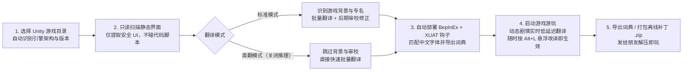

<div align="center">

# UL10nForge · Unity 游戏汉化工具

**不改动任何游戏原文件，用成熟钩子 + AI 翻译轻松汉化你的 Unity 游戏**

静态界面提前翻好 · 剧情对话边玩边实时翻 · 游戏中按 `Alt+L` 当场改译 · 支持本地离线与在线 API · 一键打包离线补丁分享

<p>
  <a href="#工作原理为什么安全">工作原理</a> ·
  <a href="#核心功能介绍">核心功能</a> ·
  <a href="#下载与安装">下载与安装</a> ·
  <a href="#三步上手">三步上手</a> ·
  <a href="#在线-api-配置参考">在线 API</a> ·
  <a href="#常见问题">常见问题</a>
</p>

</div>

---

## 工作原理：为什么安全？

传统的 Unity 汉化通常要解包、改写游戏资源文件再重新打包，不仅步骤繁琐，还很容易引发黑屏、字体乱码、坏档，游戏一更新就全部作废。

**UL10nForge 走的是完全不碰游戏原文件的「显示层钩子」路线**，底层直接集成并自动配置 Unity 社区最成熟的两套开源组件：

- **插件加载器**：`BepInEx 5 / 6`（自动识别 Mono / IL2CPP、32 位 / 64 位与 Unity 版本；IL2CPP 64 位也可一键切换 `MelonLoader`）
- **文本拦截与替换引擎**：`XUnity.AutoTranslator (XUAT)`

游戏启动时，钩子会在**文字真正显示到屏幕前的那一刻**把英文拦截下来：
1. **先查本地词典（0 延迟）**：之前翻好或人工改过的句子，直接从 `00_UL10nForge.txt` 秒出中文，不消耗任何算力或联网；
2. **新台词实时翻译并永久保存**：词典里还没有的动态剧情/新道具文本，钩子会立刻发给本工具并行翻译，翻完马上显示在画面上并自动写入本地词典——**翻过一次，以后永远秒出中文**；
3. **100% 无损可还原**：全程不改任何 `.assets`、`.dll` 或存档文件；不想用时在工作台一键卸载，只按安装清单精准清理本工具放入的文件，不会误删你原本装的其他 Mod。



---

## 核心功能介绍

### 1. 自动识别与安全钩子接入（核心底座）
- **省心识别**：选好游戏文件夹（哪怕外面套了一两层目录）即可自动识别 Mono / IL2CPP、x64 / x86、Unity 具体版本号；若目录里存在反作弊或加壳保护文件也会提前提醒。
- **IL2CPP 自动加固**：针对容易报错的 IL2CPP 游戏，自动关闭不稳定框架钩子并写入防刷屏/防冲突配置，尽量做到开箱即玩。
- **每次启动自动校验**：点击「启动游戏」前会自动确认插件、字体配置与最新词典处于同步状态。

### 2. 纯静态安全预扫 + 极低延迟实时翻译
- **克制且安全的预扫**：开玩前只读扫描 100% 安全的标准 Unity 界面文本（菜单、设置、固定按钮等），绝不乱抓脚本代码里的乱码变量；剧情对话和动态文本交由钩子在游玩时实时捕获。
- **实时翻译低延迟优先**：游戏内实时翻译绝不卡在审校上，采用长连接复用、本地 GPU 多路并行槽位，并自动结合**游戏背景、术语表、跨游戏记忆和刚说过的几句前文对话**，力求一次就翻出贴合游戏口吻的自然中文。

### 3. 本地离线模型 × 在线 API × 一键直翻模式
- **本地离线（不联网、零费用）**：
  - 主翻译模型：`Hy-MT3 1.8B`（轻快低延迟，专门负责日常与实时翻译）；
  - 背景与审校模型：`Qwen3.5 4B`（按需启动，用完空闲自动释放显存）；
  - 自动匹配显卡硬件：优先 `CUDA`（N 卡）→ 自动回退 `Vulkan`（兼容 RTX 50 系 / A 卡 / 核显）→ 纯 `CPU`。
- **在线 API（不用下载大模型、不挑显卡）**：
  - 兼容 DeepSeek、OpenAI、Gemini、豆包、智谱、阿里百炼、硅基流动等任意 OpenAI 兼容接口；
  - 批量翻译时自动打包合并发送，同时本地词库和记忆 0 Token 命中，**比逐句发送省约 70%–85% Token**；任务结束会清楚显示本次消耗的 Token 数。
- **「关闭推理与审校」直翻开关**：
  - 如果你不想跑推理模型、追求最快速度与更低显存占用，在**设置**里一键开启后，所有背景识别与审校按钮会自动隐藏，一键汉化直接走「扫描 → 翻译 → 接入游戏」。

### 4. 游戏内 `Alt+L` 悬浮改译 & 工作台实时同步
- **玩到哪改到哪**：游戏中随时按 **`Alt+L`** 呼出置顶悬浮窗（支持切换半透明、按「实时 / 全部 / 待修」筛选），改完按保存或 `Ctrl+Enter`，工具会自动更新词典并清理旧机翻残留，游戏画面立即热刷新生效。
- **完善的精修工具**：工作台译文列表每条常驻「保存」按钮，人工改过的译文自动锁定不怕被后续批量翻译覆盖；支持单条一键重译、还原上一版、标记「不翻 / 恢复」、批量查找替换。
- **后期按需审校**：游玩告一段落后，可以随时在工作台点「审校译文」，只挑出长句、否定句和术语冲突的高风险译文做复查修正，既不拖慢游玩，又能提升译文质量。

### 5. 术语表 & 跨游戏翻译记忆
- 分设**本游戏术语**、**全局术语库**和**跨游戏翻译记忆**，确保主角名字、地名、技能名在整款游戏乃至多款续作里前后一致。
- 支持搜索、点击任意一条直接原地修改、按 `原文=译名` 批量导入，以及一键清空。

### 6. 三套中文字体与实时样式预览
- 内置三套开源可商用中文字体，均已打包覆盖 Unity 2019 ~ Unity 6 的四版本字体包：
  - **思源宋体**（经典衬线：沉稳耐看，适合暗黑奇幻、恐怖悬疑、剧情向）
  - **霞鹜文楷**（温润手写：柔和舒适，适合视觉小说、RPG、治愈独立游戏）
  - **缝合像素**（复古点阵：锐利 10px 像素风，适合像素 RPG 与复古横版）
- **字号、行距和防文字溢出已自动调至最佳**，设置里只需点选字体，右侧就会直接用真实字体模拟出游戏菜单与对话气泡的实时效果，选中即生效。

### 7. 多格式导出 & 一键打包独立离线补丁
- 支持导出 **JSON / 词典 TXT / 双语对照 TXT / Markdown / CSV（Excel 打开不乱码）**。
- 支持一键打包**独立离线汉化补丁 `.zip`**（自动打好钩子、选中的中文字体与全部词典），发给朋友直接解压到游戏目录就能玩，不需要安装本工具，也不用联网。

---

## 下载与安装

### 方式一：网盘下载（推荐，高速下载）

> **网盘下载链接**
> - 夸克网盘：
链接：https://pan.quark.cn/s/a9c3df54b786
提取码：pCkt

### 方式二：GitHub Releases 下载（完整版分卷 / 按需精简包）

前往本仓库右侧 [Releases](https://github.com/mingminghh611/UL10nForge/releases) 下载。受单文件 2 GB 限制，提供以下两种下载方式，**二选一即可**：

#### 选项 A：完整版（全包含分卷，一次解压即用，最省心）

内置主程序、便携 Python、BepInEx/MelonLoader/XUAT 钩子包、三套四版本中文字体、CUDA/Vulkan 本地引擎以及翻译+审校双模型。

- 下载全部 `UL10nForge-v1.0.0-Full.7z.001` ~ `.003`（共 3 个分卷，每个 ≤ 1.85 GB）放到**同一个文件夹**；
- 使用 **7-Zip / Bandizip / WinRAR** 右键解压 **`.001`** 即可自动合并出完整的 `UL10nForge` 文件夹；
- 无需配置环境，离线直接可用，也可随时在设置里切换在线 API。

#### 选项 B：按需精简包（只用在线 API 或不想下审校模型时选这个）

按需下载下方压缩包，**全部解压到同一个目录**（保证合并到同一个 `UL10nForge` 文件夹）：

| 压缩包文件名 | 包含内容 | 适用人群 |
| :--- | :--- | :--- |
| `UL10nForge-v1.0.0-Core.zip` | 主程序 + 内置便携 Python + BepInEx/MelonLoader/XUAT 钩子包 + 三套四版本中文字体 | **必下**（仅用在线 API 只下这一个就行，约 485 MB） |
| `UL10nForge-v1.0.0-LocalEngine.zip` | 本地推理运行库（CUDA + Vulkan） | 用本地离线翻译时必下 |
| `UL10nForge-v1.0.0-Model-Translate-HyMT3.zip` | 本地主翻译模型（Hy-MT3 1.8B） | 用本地离线翻译时必下 |
| `UL10nForge-v1.0.0-Model-Reason-Qwen3.5.7z.001` / `.002` | 本地背景与审校模型（Qwen3.5 4B，解压 `.001`） | 可选（开「关闭推理与审校」直翻可不下） |

> 组合速查：
> - **纯在线 API**：只下 `Core.zip`（1 个文件）
> - **本地离线直翻**：下 `Core.zip` + `LocalEngine.zip` + `Model-Translate-HyMT3.zip`（3 个文件）
> - **本地全功能完整版**：直接选上面 **选项 A** 的 `Full.7z.001` ~ `.003`（3 个文件）

解压完成后，双击文件夹内的 **`启动UL10nForge.bat`**，会自动在浏览器打开工作台（默认 `http://127.0.0.1:18765`）。

### 方式三：从源码运行（开发者 / 纯在线 API）

需要 Windows 10/11、Python 3.12+：

```bash
git clone https://github.com/mingminghh611/UL10nForge.git
cd UL10nForge
pip install -r requirements.txt
python main.py
```

---

## 三步上手

1. **打开游戏**：点击「打开游戏」，选择 Unity 游戏所在的文件夹。
2. **一键自动汉化**：点击「一键自动汉化」，自动完成静态界面扫描、翻译，并把 `BepInEx + XUnity.AutoTranslator` 钩子和中文字体接入游戏。
3. **启动游玩**：点击「启动游戏」直接开玩。遇到动态剧情会自动实时翻译；想改哪句译文，在游戏中按 **`Alt+L`** 呼出悬浮窗直接改完保存即可。

---

## 在线 API 配置参考

在工作台 **设置 → 运行方式 → 在线 API** 中填入以下信息并点「测试连接」即可（审校接口留空会自动复用翻译接口）：

| 服务商 | 接口地址（Base URL） | 常用模型示例 |
| :--- | :--- | :--- |
| **DeepSeek** | `https://api.deepseek.com/v1` | `deepseek-chat` |
| **OpenAI** | `https://api.openai.com/v1` | `gpt-4o-mini` |
| **Google Gemini** | `https://generativelanguage.googleapis.com/v1beta/openai` | `gemini-2.5-flash` |
| **火山引擎（豆包）** | `https://ark.cn-beijing.volces.com/api/v3` | 对应接入点 Endpoint ID |
| **智谱 GLM** | `https://open.bigmodel.cn/api/paas/v4` | `glm-4-flash` |
| **阿里百炼** | `https://dashscope.aliyuncs.com/compatible-mode/v1` | `qwen-plus` / `qwen-turbo` |
| **硅基流动** | `https://api.siliconflow.cn/v1` | `Qwen/Qwen2.5-7B-Instruct` |

---

## 常见问题

<details>
<summary><b>1. 会破坏游戏原文件或导致坏档吗？怎么恢复原版？</b></summary>

完全不会。本工具只向游戏目录写入独立的钩子插件与词典文件，不改动任何游戏原文件或存档。随时在工作台「更多 ▾ → 卸载汉化插件」即可清理干净，且不会误删你原本安装的其他 Mod。
</details>

<details>
<summary><b>2. 为什么有些游戏扫出来的静态文本很少，甚至为 0？</b></summary>

为了绝对安全，扫描只读取静态界面文本，绝不触碰脚本和代码。许多游戏的剧情与菜单是在运行期动态加载的，直接点「启动游戏」玩到对应画面，钩子会自动实时翻译并永久保存到词典里。
</details>

<details>
<summary><b>3. 游戏中按 <code>Alt+L</code> 没弹出悬浮窗，或被游戏画面挡住了？</b></summary>

请在工作台「更多 ▾」勾选「无边框启动游戏」，或在游戏画质设置里切换为「无边框窗口」模式（独占全屏下系统悬浮窗无法置顶）。若 `Alt+L` 被其他软件占用，工具会自动回退到 `Alt+Shift+L` 或 `Ctrl+Shift+L`。
</details>

<details>
<summary><b>4. 全新 Windows 电脑启动本地模型提示缺少 DLL 怎么办？</b></summary>

安装微软官方的 **Visual C++ 2015–2022 Redistributable (x64)** 即可。如果只使用在线 API，不需要下载本地引擎和模型。
</details>

---

## 致谢与开源许可

本项目离不开以下优秀的开源项目与免费开源字体，在此致谢：

- 钩子与加载器：[BepInEx](https://github.com/BepInEx/BepInEx)（[协议](BepInEx-LICENSE.txt)） · [XUnity.AutoTranslator](https://github.com/bbepis/XUnity.AutoTranslator)（[协议](XUnity.AutoTranslator-LICENSE.txt)） · [MelonLoader](https://github.com/LavaGang/MelonLoader)
- 运行库与框架：[llama.cpp](https://github.com/ggml-org/llama.cpp) · [UnityPy](https://github.com/K0lb3/UnityPy) · [FastAPI](https://github.com/fastapi/fastapi)
- 内置开源中文字体：[思源宋体 Noto Serif CJK](https://github.com/notofonts/noto-cjk) · [霞鹜文楷 LXGW WenKai](https://github.com/lxgw/LxgwWenKai) · [缝合像素字体 Fusion Pixel](https://github.com/TakWolf/fusion-pixel-font)

> 本工具仅用于个人游戏本地化学习与体验辅助，请支持正版游戏，遵守相关开源许可协议。
