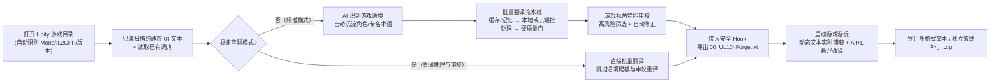

<div align="center">

# UL10nForge · Unity 游戏本地化工坊

**零侵入、纯显示层的 Unity 游戏智能汉化工作台**

绝不改动任何游戏原文件 · 支持本地离线双模型、极速直翻与省 Token 云端 API · 静态预扫 + 游戏内实时补全 + `Alt+L` 悬浮改译

<p>
  
  
  
  
  
</p>

<p>
  <a href="#核心特性">核心特性</a> ·
  <a href="#工作原理">工作原理</a> ·
  <a href="#快速开始">快速开始</a> ·
  <a href="#模型与云端-api-配置">模型与云端 API</a> ·
  <a href="#项目结构">项目结构</a> ·
  <a href="#常见问题">常见问题</a>
</p>

</div>

---

## 为什么选择 UL10nForge？

传统的 Unity 游戏汉化通常陷入两难：**解包回写资产**容易导致黑屏、坏档，且游戏一更新就失效；**普通实时机翻插件**虽然安全，却缺乏上下文与术语约束，改译繁琐，遇到 IL2CPP 或旧版 Unity 字体也容易报错乱码。

**UL10nForge** 结合了两者的优点：底层以 `BepInEx / MelonLoader + XUnity.AutoTranslator` 仅在显示层无损替换文本，上层提供完整的 AI 翻译流水线、可选的语境与审校引擎、极速直翻模式、术语记忆库、可视化精修工作台与独立离线补丁打包。

| 对比维度 | 传统解包改包 | 普通实时机翻插件 | **UL10nForge** |
| :--- | :--- | :--- | :--- |
| **游戏安全性** | 修改原文件，易崩/坏档 | 零侵入，但 IL2CPP 配置易踩坑 | **100% 零侵入** + IL2CPP 安全加固 + 反作弊/加壳预警 + 保护原有 Mod |
| **翻译质量** | 依赖人工维护 | 逐句孤立直译，人名术语分裂 | **语境档案 + 术语库 + 跨游戏记忆 + 质量门 + 智能审校**（可按需开关） |
| **速度与显存** | 需反复解包打包 | 实时阻塞易卡顿 | 支持**极速直翻模式**（一键关闭推理与审校，跳过建模直接翻译接入） |
| **云端 Token 成本** | — | 逐句调用，重复开销高 | **JSON 编号批处理 + 0 Token 本地缓存记忆**，云端输入 Token 降约 70%–85% |
| **精修与分享** | 需退出重打包 | 手动编辑 `.txt` 词典 | 游戏中 **`Alt+L` 悬浮即时改译** + 多格式导出 + 一键打包**离线补丁 `.zip`** |

---

## 核心特性

### 1. 100% 游戏安全与全版本兼容
- **自动识别 Unity 工程结构**：纯 Python 探测 `Mono / IL2CPP`、`x64 / x86`、Unity 具体版本号与多层嵌套目录，自动提示检测到的反作弊/加壳保护文件（如 `CARLProtect`）。
- **IL2CPP 专属安全加固**：针对 IL2CPP 游戏仅启用稳定的 `UGUI` 与 `TextMeshPro` 钩子，自动关闭易引发 `Il2CppInterop` 报错的裁剪框架与纹理/作用域钩子，写入 `DisableTextMeshProScrollInEffects=True`、`TemplateAllNumberAway=True`、`UnityLogListening=false` 与静默安全模式。
- **字体版本精确匹配**：根据 Unity 版本自动匹配 `u2019 / u2021 / u2022 / u6000` 预编译 TMP 中文字体包，Unity `< 2019` 自动跳过不兼容字体包，避免老游戏乱码或崩溃。
- **启动自愈与精准卸载**：点击「启动游戏」自动确保插件部署、安全配置与最新词典同步；卸载严格按部署清单清理，绝不误删玩家原有的其他 Mod。

### 2. 纯静态安全预扫 × 实时动态补全
- **克制的静态扫描**：只读扫描 100% 安全的标准 Unity UI 组件（`TextMeshProUGUI` / `TextMeshPro` / `TMP_Text` / `Text` / `TextMesh`），拒绝抓取脚本、代码与二进制噪音；动态剧情与拼接文本交由游戏内钩子实时捕获。
- **来源与状态正交筛选**：支持按 **全部来源 / 静态文本 / 实时翻译** 与词条状态自由组合筛选，翻译进度与游戏内实时捕获通过 SSE 自动推送刷新。

### 3. 本地离线双模型 × 极速直翻 × 省 Token 云端 API
- **本地全离线（零联网、零隐私上传）**：
  - 主翻译引擎：`Hy-MT3-1.8B`（低延迟并发翻译）；
  - 语境与审校引擎：`Qwen3.5-4B`（按需自动拉起，空闲自动释放显存）；
  - 硬件自适应：`CUDA 12.4 → Vulkan（兼容 RTX 50 系 / AMD / Intel）→ CPU` 自动降级。
- **极速直翻模式（关闭推理与审校）**：
  - 在 **设置 → 翻译引擎** 一键开启，立即释放推理模型显存并隐藏全局所有语境与审校按钮；
  - 点击「一键自动汉化」跳过语境建模与审校重译，直接执行「**扫描 → 批量翻译 → 接入游戏**」，速度更快、显存占用更低。
- **省 Token 云端 API（OpenAI 兼容）**：
  - 原生适配 DeepSeek、OpenAI、Google Gemini、火山引擎豆包、智谱 GLM、阿里百炼、硅基流动等服务商；
  - 自动规范化网关地址、剥离 `<think>` 推理块、支持 `429 / 5xx` 退避重试与 `Retry-After`；
  - **JSON 编号批处理 + 严格单条质检回退**：内置 UI 词表与跨游戏记忆 0 Token 命中，其余打包批翻，任意条目遗漏或占位符受损自动单条回退重译，结束后实时显示本次 Token 消耗。

### 4. 高质感工作台、术语记忆与多格式导出
- **顺手的精修交互**：每条译文常驻「保存」按钮，支持失焦或 `Ctrl+Enter` 自动保存并实时同步游戏；支持人工修改防覆盖保护、单条一键还原上一版、标记「不翻 / 恢复」、全局批量查找替换，以及游戏中随时按 **`Alt+L`** 呼出的悬浮改译窗。
- **完整术语与翻译记忆管理**：分设「本游戏术语」「全局术语库」「跨游戏翻译记忆」，支持搜索、点击直接内联修改、`原文=译名` 批量导入与一键清空。
- **克制的听觉与视觉体验**：深浅双主题切换、`Ctrl+K` 全局快捷指令面板，以及纯 Web Audio API 合成的轻柔交互音效（零外部音频依赖，右上角一键静音）。
- **多格式导出 & 独立离线补丁**：一键导出 **JSON / 词典 TXT / 双语对照 TXT / Markdown / CSV（Excel 无乱码）**，或打包可发给任意玩家「解压即玩、无需本工具与联网」的**独立离线中文补丁 `.zip`**。

---

## 工作原理



---

## 快速开始

### 方式一：解压即用便携版（推荐）

从 [Releases](https://github.com/mingminghh611/UL10nForge/releases) 下载整合包并解压到任意目录，双击根目录下的：

```bat
启动UL10nForge.bat
```

脚本会自动优先调用内置便携 Python 启动本地工作台并打开浏览器（默认 `http://127.0.0.1:18765`）。

### 方式二：从源码运行（开发者 / 云端 API 用户）

环境要求：**Windows 10/11**、**Python 3.12+**。

```bash
# 1. 克隆仓库
git clone https://github.com/mingminghh611/UL10nForge.git
cd UL10nForge

# 2. 安装依赖
pip install -r requirements.txt

# 3. 启动工作台
python main.py
```

#### 启动参数

| 参数 | 说明 | 默认值 |
| :--- | :--- | :--- |
| `--host` | 监听地址 | `127.0.0.1` |
| `--port` | 服务端口（`0` 表示读取设置项） | `18765` |
| `--no-browser` | 启动后不自动打开浏览器 | 关闭 |
| `--no-overlay` | 不注册游戏内 `Alt+L` 全局悬浮窗快捷键 | 关闭 |

### 三步汉化一款游戏

1. **打开游戏**：点击「打开游戏」，选择 Unity 游戏根目录（或外层包裹目录，工具会自动定位）。
2. **一键自动汉化**：点击「一键自动汉化」，自动依次完成扫描、翻译（标准模式含语境与智能审校，极速直翻模式直接翻译）与安全接入。
3. **启动游玩 & 实时精修**：点击「启动游戏」直接开玩；画面中新出现的动态文本会自动实时翻译并沉淀到本地词典，随时按 **`Alt+L`** 呼出悬浮窗微调，保存即生效。

---

## 模型与云端 API 配置

### 1. 云端 API（无需显卡、无需下载本地大模型）

进入 **设置 → 运行方式 → 在线 API**，填写接口地址、模型名称与 API Key 后点击「测试连接」并保存。若未开启「关闭推理与审校」，审校接口留空时会自动无缝复用翻译接口。

| 服务商 | Base URL 示例 | 推荐模型示例 |
| :--- | :--- | :--- |
| **DeepSeek** | `https://api.deepseek.com/v1` | `deepseek-chat` |
| **OpenAI** | `https://api.openai.com/v1` | `gpt-4o-mini` |
| **Google Gemini** | `https://generativelanguage.googleapis.com/v1beta/openai` | `gemini-2.5-flash` |
| **火山引擎（豆包）** | `https://ark.cn-beijing.volces.com/api/v3` | 对应接入点 Endpoint ID |
| **智谱 GLM** | `https://open.bigmodel.cn/api/paas/v4` | `glm-4-flash` |
| **阿里百炼** | `https://dashscope.aliyuncs.com/compatible-mode/v1` | `qwen-plus` / `qwen-turbo` |
| **硅基流动** | `https://api.siliconflow.cn/v1` | `Qwen/Qwen2.5-7B-Instruct` |

### 2. 本地离线资源目录约定（源码运行时按需放置）

为保持源码仓库轻量，大体积二进制运行库、模型与插件包不纳入 Git 跟踪，本地离线部署请按以下目录结构放置：

```text
UL10nForge/
├── models/                                  # 本地 GGUF 模型
│   ├── Hy-MT3-1.8B-Q8_0.gguf                # 主翻译模型
│   └── Qwen3.5-4B-Q4_K_M.gguf               # 语境与审校推理模型（极速直翻模式可不放）
├── runtime/                                 # 运行时环境
│   ├── python/                              # 便携版 Python 3.12（可选）
│   ├── llama-cuda/                          # llama-server CUDA 12.4 后端
│   └── llama-vulkan/                        # llama-server Vulkan 通用后端
├── resources/hook_kits/                     # BepInEx 5/6、MelonLoader、XUAT 5.6.3.1 插件包
└── fonts/
    ├── SimplifiedChinese/                   # NotoSerifCJKsc-Medium.ttf
    └── TMP_Font_AssetBundles/               # notoserif_sdf_u2019 / u2021 / u2022 / u6000
```

---

## 项目结构

```text
UL10nForge/
├── main.py                        # 程序入口（FastAPI 服务 + 浏览器 + Alt+L 悬浮窗）
├── 启动UL10nForge.bat             # Windows 一键启动脚本（优先调用内置便携 Python）
├── requirements.txt               # Python 依赖清单
├── pytest.ini                     # 测试配置
├── docs/
│   └── architecture.md            # 分层架构设计文档
├── tests/                         # 自动化回归测试套件（21 项测试）
└── ul10n/
    ├── core/                      # 领域模型、持久化与纯规则层
    │   ├── models.py              # 核心数据模型与设置项
    │   ├── db.py                  # 双 SQLite 仓库（global.db + 单游戏 project.db，WAL）
    │   ├── game_detector.py       # Unity 版本 / Mono & IL2CPP / PE 架构 / 保护文件探测
    │   ├── hook_deployer.py       # Hook 无损部署、IL2CPP 加固、安全卸载与离线补丁打包
    │   ├── text_scanner.py        # 纯静态 Unity UI 组件只读扫描器
    │   ├── xuat_codec.py          # XUAT 词典编解码与 round-trip 校验
    │   ├── quality.py             # 占位符/富文本保护、内置 UI 词表与质量门
    │   └── exporter.py            # JSON / TXT / 双语对照 / Markdown / CSV 导出
    ├── engine/                    # AI 推理与翻译智能体层
    │   ├── llm_client.py          # OpenAI 兼容客户端（多网关规范化 / 思考块剥离 / Token 统计）
    │   ├── runtime_manager.py     # 本地 llama-server 生命周期、显存释放与硬件自适应
    │   ├── context_builder.py     # 游戏语境抽样归纳与专名入库
    │   ├── translator.py          # 单条实时翻译 + 云端省 Token JSON 批处理流水线
    │   ├── reviewer.py            # 智能高风险筛选 + 游戏视角批量审校与克制修正
    │   └── tasks.py               # 后台任务调度与 SSE 事件总线
    ├── overlay/
    │   └── hud.py                 # 游戏内 Alt+L 全局快捷键悬浮改译窗
    ├── server/
    │   ├── app.py                 # FastAPI 接口（/api/*、/xuat/translate/*、SSE）
    │   └── state.py               # 服务编排与实时词典防抖热同步
    └── web/                       # 零构建深浅双主题 WebUI（含 Web Audio 交互音效）
        ├── index.html
        ├── styles.css
        └── app.js
```

---

## 运行测试

```bash
pytest -v
```

21 项自动化测试覆盖：Unity 游戏识别与嵌套目录探测、Mono / IL2CPP Hook 安全部署与卸载（含保护原有 Mod）、XUAT 编解码 round-trip 校验、多语种质量门、云端多网关 URL 规范化与省 Token 批处理回退、智能审校与复审、极速直翻（关闭推理）模式与音效设置持久化、术语/记忆完整增删改查以及全链路 HTTP API。

---

## 常见问题

<details>
<summary><b>1. 汉化会修改或损坏游戏原文件吗？怎么恢复原版？</b></summary>

完全不会。UL10nForge 只向游戏目录写入独立的插件与词典文件，绝不修改任何 `.assets` / `.dll` / 存档文件。随时在工作台「更多 ▾ → 卸载汉化插件」即可按部署清单精准清理干净，不会误删你原本安装的其他 Mod。
</details>

<details>
<summary><b>2. 我只想快速翻译接入，不想跑推理模型和审校怎么办？</b></summary>

打开 **设置 → 翻译引擎**，开启「**关闭推理与审校（极速直翻）**」开关即可立即生效：推理模型显存自动释放，界面中所有审校与语境按钮都会干净隐藏，点击「一键自动汉化」将直接执行「扫描 → 翻译 → 接入游戏」。
</details>

<details>
<summary><b>3. 为什么有些游戏扫描出来的静态文本很少甚至为 0？</b></summary>

为保证 100% 游戏安全与高译文纯净度，静态扫描只读取纯静态 UI 组件文本；许多游戏的对话与菜单是在运行期由脚本、表文件或代码动态生成的。此时直接点「启动游戏」，玩到哪一屏钩子就会自动实时翻译并写入词典，下次进游戏直接秒出中文。
</details>

<details>
<summary><b>4. 游戏中按 <code>Alt+L</code> 没有弹出悬浮窗或被画面挡住怎么办？</b></summary>

1. 若游戏运行在「独占全屏」，系统级悬浮窗可能无法置顶——请在工作台「更多 ▾」勾选「无边框启动游戏」，或在游戏设置中切换为「无边框窗口」模式；
2. 若 `Alt+L` 与其他软件热键冲突，工具会自动回退到 `Alt+Shift+L` 或 `Ctrl+Shift+L`，也可在工作台直接点击「悬浮窗 (Alt+L)」呼出。
</details>

<details>
<summary><b>5. 把便携版发给全新纯净 Windows 电脑，还需要装什么吗？</b></summary>

便携版已内置独立 Python 3.12 运行时、模型、字体与钩子包，绝大多数 Windows 10/11 可直接双击运行。仅在极少数缺少系统运行库的电脑上，若本地 `llama-server` 提示缺少 DLL，安装微软官方 **Visual C++ 2015–2022 Redistributable (x64)** 即可。
</details>

---

## 致谢与协议

本项目基于以下优秀开源生态构建，在此致谢：

- [BepInEx](https://github.com/BepInEx/BepInEx)（协议见 [BepInEx-LICENSE.txt](BepInEx-LICENSE.txt)）
- [XUnity.AutoTranslator](https://github.com/bbepis/XUnity.AutoTranslator)（协议见 [XUnity.AutoTranslator-LICENSE.txt](XUnity.AutoTranslator-LICENSE.txt)）
- [MelonLoader](https://github.com/LavaGang/MelonLoader) · [llama.cpp](https://github.com/ggml-org/llama.cpp) · [UnityPy](https://github.com/K0lb3/UnityPy) · [FastAPI](https://github.com/fastapi/fastapi)

> 本工具仅用于游戏本地化学习与个人体验辅助，请支持正版游戏，遵守游戏发行商与开源组件的相关许可协议。
